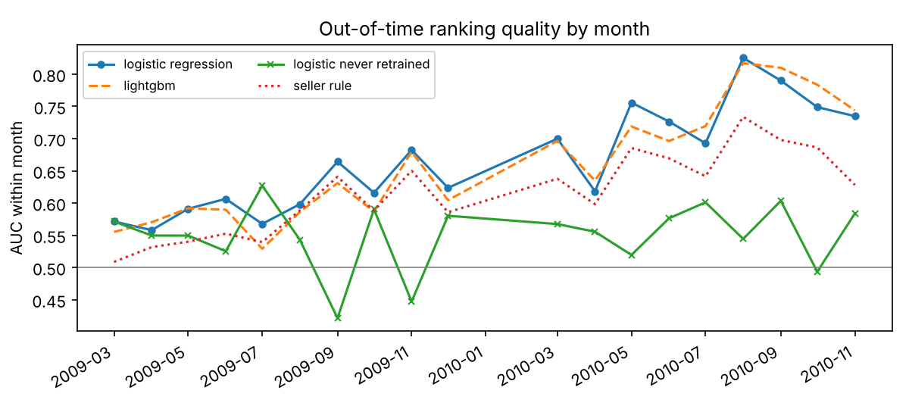

# Lead Prioritization on Microsoft Fabric (PySpark, Medallion Architecture)

A lead conversion pipeline built for **Microsoft Fabric**: raw outbound sales calls land in a
lakehouse, flow through **bronze, silver, and gold** layers in PySpark with data quality gates, and
end in a model-ready feature table for scoring which leads a seller should call next.

The same code runs **locally** (Spark in local mode, Parquet tables) and **in a Fabric notebook**
(managed Delta tables that Power BI can read in Direct Lake mode), so every layer is testable in CI.

> **Status:** data foundation and model are complete: medallion pipeline, rolling monthly backtest,
> champion model with reason codes, and a ranked call list. The Power BI report is next.

## Data

UCI **Bank Marketing** dataset: 41,188 outbound sales calls by a Portuguese bank, May 2008 to
November 2010, with whether each lead converted (CC BY 4.0, see `data/raw/SOURCE.md`).

## Medallion layers

| Layer | Table | What happens |
|---|---|---|
| Bronze | `bronze_bank_calls` | Raw file landed as-is (all strings) with lineage columns: `source_row_number`, `source_file`, `ingested_at` |
| Silver | `silver_calls` | Typed and renamed columns, sentinel values handled, exact duplicates removed, call dates reconstructed |
| Gold | `gold_lead_features` | Pre-call features plus label, one row per lead, ready for modeling |
| Gold | `gold_campaign_monthly` | Monthly calls, conversions, and economic indicators for reporting and drift analysis |

## Data quality decisions

- **Reconstructing dates.** The file is in date order but only has the month. Bronze captures the
  original row order before anything can reorder it, and silver starts a new year whenever the month
  number goes backwards. A quality check confirms the result matches the documented range
  (May 2008 to November 2010) exactly.
- **Sentinel values.** `pdays = 999` means "never contacted before," not 999 days, so it becomes null
  plus a `was_previously_contacted` flag.
- **Duplicates.** 12 rows that are exact copies on every field are removed, keeping the first.
- **Leakage guard.** `call_duration_sec` is only known after the call ends (a 0-second call is always a
  non-conversion), so it is excluded from the gold feature table and a test enforces it.

Nine quality checks run between layers and stop the pipeline on failure (`src/leadscore/quality.py`).

## What the gold layer already shows

The data covers the 2008 financial crisis, and the campaign changed completely as rates fell:

| Year | Calls | Conversion rate | Avg 3-month Euribor | Share of calls to past leads |
|---|---|---|---|---|
| 2008 | 27,682 | 4.8% | 4.6% | 0.1% |
| 2009 | 11,436 | 19.5% | 1.0% | 13.9% |
| 2010 | 2,058 | 52.1% | 0.8% | 35.2% |

The bank cut call volume sharply and shifted to re-contacting past leads, and conversion rose more
than tenfold. A model trained on 2008 behavior will not transfer to 2010 without retraining, which is
why the modeling stage uses time-based validation instead of random splits.

## Model results (out of time)

Every month from March 2009 to November 2010 is scored by a model trained only on earlier months.

| Model | AUC within month | Top 20% of calls captures |
|---|---|---|
| **Logistic regression (champion)** | **0.613** | **28.8%** of conversions |
| LightGBM (challenger) | 0.611 | 28.3% |
| Seller rule: call past successes first | 0.568 | 27.0% |
| Logistic regression trained once, never retrained | 0.548 | 24.8% |



**What the experiments showed** (details in [`docs/model_card.md`](docs/model_card.md)):

- **Retraining is the biggest lever.** A model trained once drifts toward a coin flip as the market
  changes, while monthly retraining climbs to an AUC of 0.74 to 0.82 in late 2010.
- **Simpler won.** Logistic regression matched LightGBM, so it is the champion: equal accuracy,
  and its explanations are exact.
- **Timing matters more than targeting.** Economic conditions move conversion from about 5% to over
  50%, while ranking leads within a month adds a real but modest lift (1.6x to 1.7x for the top two deciles in the latest three months).
- **Honest calibration.** Recalibrating on recent months made probabilities worse, so the model card
  documents that top-decile probabilities run optimistic and scores should be used for ranking.

**Ranked call list with reasons**, measured against the other leads that month (`gold_lead_scores`):

| Lead | Month | Score | Reason 1 | Reason 2 | Reason 3 |
|---|---|---|---|---|---|
| L040560 | 2010-09 | 0.76 | Contacted in an earlier campaign | Previous campaign outcome: success | Job: student |
| L040736 | 2010-09 | 0.74 | Contacted in an earlier campaign | Job: retired | Previous campaign outcome: success |

Full tables (calibration by decile, lift by decile, more of the call list) are in
[`docs/results.md`](docs/results.md).

## Run it

```bash
pip install -e ".[local]"             # needs Java 11+ for PySpark
python -m pytest -q tests             # unit tests for the transforms
python scripts/run_data_pipeline.py   # bronze -> silver -> gold with quality gates
python scripts/run_model.py           # backtest, score, explain -> gold model tables + docs/results.md
```

**In Microsoft Fabric:** upload `data/raw/bank-additional-full.csv` to the lakehouse at `Files/raw/`,
attach the `leadscore` wheel (`python -m build`) through a Fabric Environment, and run
`notebooks/01_build_lakehouse.ipynb`, then `notebooks/02_backtest_and_score.ipynb`. Tables are written
as Delta with `saveAsTable`, and backtest metrics are logged to Fabric's built-in MLflow.

## Project layout

```
src/leadscore/lakehouse.py   # read/write tables the same way locally and in Fabric
src/leadscore/pipeline.py    # bronze, silver, gold transforms
src/leadscore/quality.py     # data quality checks between layers
src/leadscore/modeling.py    # backtest, champion model, scoring, reason codes
notebooks/                   # Fabric notebooks
tests/                       # PySpark unit tests
```

## Roadmap

- Power BI report on the gold tables (Direct Lake): monthly model health, lift, and the call list
- Fairness review of scores and outcomes across age groups
- AI assistant on top of the gold tables to answer questions like "why did conversion drop?"
