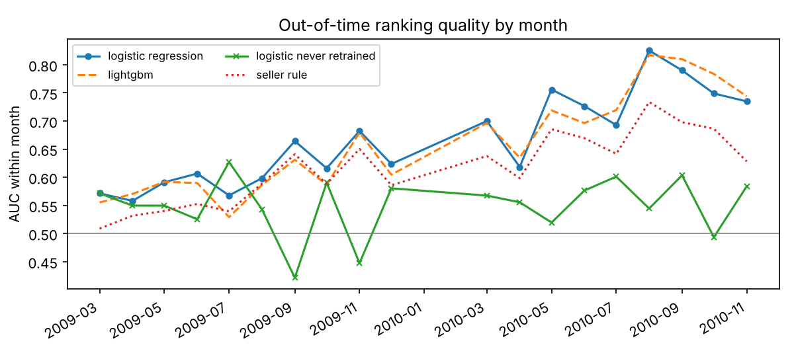

# Results (generated by scripts/run_model.py)

Rolling monthly backtest: 19 months, each scored by a model trained only on earlier months.

| Model | AUC (within month) | Top 20% of calls captures | Brier |
|---|---|---|---|
| logistic regression | 0.613 | 28.8% of conversions | 0.167 |
| lightgbm | 0.611 | 28.3% of conversions | 0.156 |
| seller rule | 0.568 | 27.0% of conversions | n/a |
| logistic never retrained | 0.548 | 24.8% of conversions | 0.241 |

## Calibration (pooled out-of-time predictions)

| Score decile | Leads | Avg predicted | Actual rate |
|---|---|---|---|
| 1 | 1350 | 4.6% | 14.8% |
| 2 | 1349 | 8.2% | 8.8% |
| 3 | 1349 | 10.7% | 11.4% |
| 4 | 1350 | 12.9% | 10.7% |
| 5 | 1349 | 15.6% | 13.8% |
| 6 | 1349 | 21.1% | 19.4% |
| 7 | 1350 | 26.2% | 25.8% |
| 8 | 1349 | 33.1% | 35.4% |
| 9 | 1349 | 54.9% | 46.0% |
| 10 | 1350 | 83.7% | 58.4% |

## Lift on the latest 3 months (635 leads)

| Priority decile | Cumulative share of leads | Cumulative share of conversions | Lift |
|---|---|---|---|
| 1 | 9.8% | 16.9% | 1.74x |
| 2 | 19.7% | 32.2% | 1.64x |
| 3 | 29.8% | 47.8% | 1.61x |
| 4 | 39.8% | 58.8% | 1.48x |
| 5 | 49.9% | 71.1% | 1.42x |
| 6 | 59.7% | 81.7% | 1.37x |
| 7 | 69.8% | 88.7% | 1.27x |
| 8 | 79.8% | 93.4% | 1.17x |
| 9 | 89.8% | 97.7% | 1.09x |
| 10 | 100.0% | 100.0% | 1.00x |

## Sample of the ranked call list

| Lead | Month | Score | Reason 1 | Reason 2 | Reason 3 |
|---|---|---|---|---|---|
| L040560 | 2010-09 | 0.76 | Contacted in an earlier campaign | Previous campaign outcome: success | Job: student |
| L040736 | 2010-09 | 0.74 | Contacted in an earlier campaign | Job: retired | Previous campaign outcome: success |
| L040587 | 2010-09 | 0.73 | Contacted in an earlier campaign | Job: retired | Previous campaign outcome: success |
| L040662 | 2010-09 | 0.73 | Contacted in an earlier campaign | Previous campaign outcome: success | Job: student |
| L040643 | 2010-09 | 0.73 | Contacted in an earlier campaign | Job: retired | Previous campaign outcome: success |
| L040735 | 2010-09 | 0.73 | Contacted in an earlier campaign | Previous campaign outcome: success | Job: student |
| L040557 | 2010-09 | 0.72 | Contacted in an earlier campaign | Job: retired | Previous campaign outcome: success |
| L040574 | 2010-09 | 0.72 | Contacted in an earlier campaign | Previous campaign outcome: success | Job: student |
